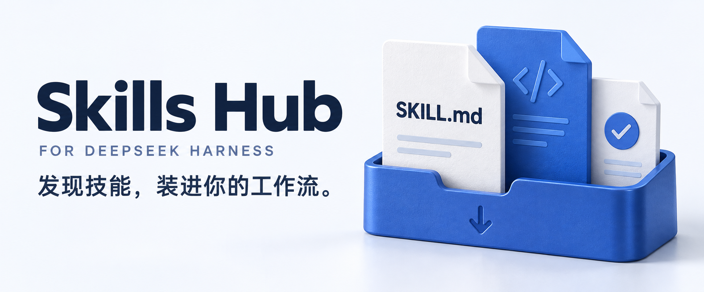
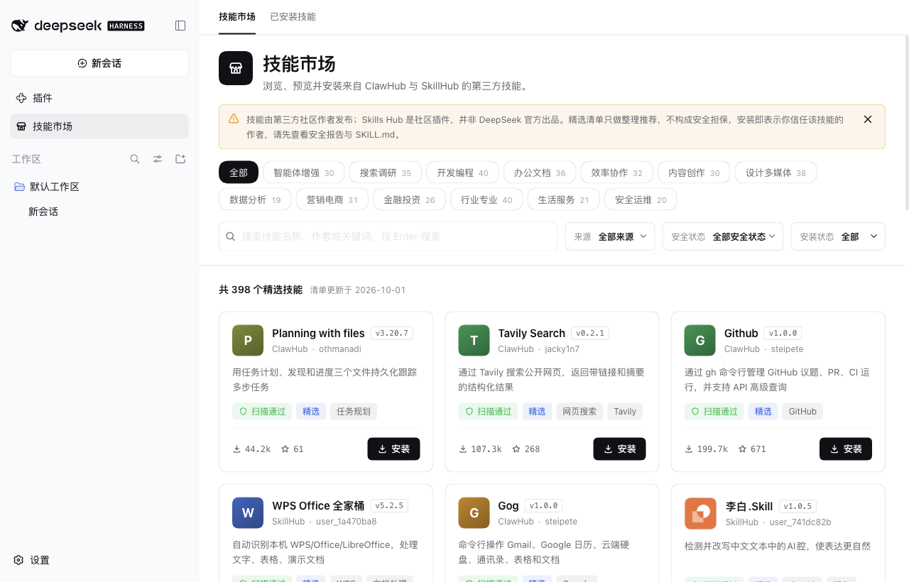

<p align="right">
  <strong>简体中文</strong> · <a href="./README_EN.md">English</a>
</p>

<p align="center">
  
</p>

<p align="center">
  <strong>DeepSeek Harness 的技能市场与本机技能管理器</strong><br>
  浏览 ClawHub 与 SkillHub，找到适合你的技能。
</p>

<p align="center">
  <a href="#快速开始">快速开始</a> · <a href="./docs/COMPATIBILITY.md">兼容性</a> · <a href="./LICENSE">MIT</a>
</p>

## 在 Harness 里发现、安装和管理技能

搜索 ClawHub 和 SkillHub 中的技能，阅读使用说明，再安装到 Harness。市场安装的技能和本机已有技能，都可以在「已安装技能」中查看和管理。

当前版本：**0.0.5**，适配 **DeepSeek Harness 0.2.1-rc.1 / rc.2**，修复 rc.2 安装兼容性，保留精选清单、预览和技能管理功能。[更新说明](./release-notes/v0.0.5.md)

<p align="center">
  
</p>

| 功能 | 说明 |
| --- | --- |
| **精选清单** | 398 个 ClawHub 与 SkillHub 热门技能，按 13 个分类整理，随插件发布，打开即看。 |
| **实时搜索** | 先搜索精选清单，再点击「在全部市场中搜索」查询两个市场；ClawHub 详情与安装按作者定位。 |
| **安装前预览** | 阅读说明和文件，查看上游安全扫描，以及技能会执行的命令、读取的密钥和访问的网络。 |
| **管理已安装技能** | 搜索本机技能，查看来源与安装位置，确认后卸载。 |
| **本地缓存** | 缓存已浏览的分页、详情和文件预览，重启后继续使用。 |

## 快速开始

适用于 **DeepSeek Harness 0.2.1-rc.1 / rc.2**。[兼容版本](./docs/COMPATIBILITY.md)

打开 **DeepSeek Harness 桌面端 → 插件 → 添加插件**，将「安装源」切换为 **官方 npm 源**，再粘贴以下任意一种内容：

大陆镜像可能尚未同步新版本，出现「未找到相关插件」或解析到旧版时，请先切换安装源。切换 GitHub 的 Latest 标记不会刷新 npm 镜像。

**npm 包名（推荐，固定版本）**

```text
@nanmicoder/dsh-skills-hub@0.0.5
```

**或 GitHub 仓库地址**

```text
https://github.com/NanmiCoder/dsh-skills-hub
```

点击 **安装 → 立即启用**，然后从侧栏进入 **技能市场**。更新后若宿主提示重启，请完全退出再重新打开。

仍使用 **Harness 0.2.0-rc.2** 时，请安装 `@nanmicoder/dsh-skills-hub@0.0.3`；0.0.5 仅声明支持 0.2.1-rc.1 和 0.2.1-rc.2，不包含尚未验证的后续宿主版本。

## 使用

1. **查找**：按分类浏览或搜索精选清单，需要更多结果时点击「在全部市场中搜索」。
2. **预览**：打开技能，查看说明和文件内容。
3. **安装与管理**：确认安装后，到「已安装技能」中查看或卸载。

技能由第三方社区作者发布；Skills Hub 是社区插件，并非 DeepSeek 官方出品。精选清单只做整理推荐，不构成安全担保，安装前请查看安全报告与 SKILL.md。

## 已安装技能

在「已安装技能」中，可以统一查看和卸载市场安装及本机已有的用户技能。项目内技能和 Harness 内置技能不在此列表中。

卸载前会显示具体位置，供你确认。若只想移除 Skills Hub 插件，在桌面端 **插件** 页面打开 **@nanmicoder/dsh-skills-hub**，点击 **卸载**；已安装的技能会保留。

## 致谢与版权

Skills Hub 的技能全部来自 [ClawHub](https://clawhub.ai) 和 [SkillHub](https://skillhub.cn)。感谢这两个平台的维护者，以及在上面发布技能的每一位作者。本插件只是让你在 Harness 里更方便地找到并安装这些技能。

- **技能版权归原作者所有**，以每个技能自己声明的许可证为准。本仓库的 MIT 许可证只适用于 Skills Hub 插件自身的代码，不适用于任何技能。
- **安装时从上游实时下载**。本仓库不托管、不转售任何技能内容。随插件发布的精选清单只包含名称、简介、分类和下载数等索引信息，用于展示，并附带指向原始页面的链接。
- **ClawHub、SkillHub 及其标识归各自所有者所有**。Skills Hub 是独立的社区项目，与 ClawHub、SkillHub 及 DeepSeek 均无隶属或背书关系。
- 如果你是技能作者或平台方，希望调整或移除展示的信息，请[提交 issue](https://github.com/NanmiCoder/dsh-skills-hub/issues)，我们会尽快处理。

[反馈问题](https://github.com/NanmiCoder/dsh-skills-hub/issues) · [高级配置](./docs/CONFIGURATION.md) · [参与开发](./CONTRIBUTING.md) · [MIT 许可证](./LICENSE)
